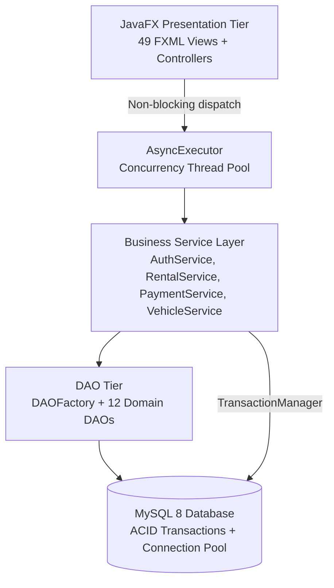

# 🚗 Fleet Management & Car Rental System

[](https://www.oracle.com/java/)
[](https://openjfx.io/)
[](https://www.mysql.com/)
[](LICENSE)

An enterprise-grade desktop car rental, telematics, and fleet management platform engineered with modern **JavaFX 17**, **Raw JDBC**, **ACID-compliant MySQL 8**, **jBCrypt salted security**, and an **asynchronous event-driven architecture**.

---

## 🌟 Modernization & Architecture Highlights

Migrated and re-engineered from a legacy single-tier prototype to an enterprise N-Tier architectural pattern:

1. **Security & Cryptography**:
   - Replaced legacy plaintext/MD5 storage with **jBCrypt** 12-round salted hashing (`PasswordUtil`).
2. **ACID Relational Storage**:
   - Replaced flat `.txt` file operations with a normalized 12-table MySQL 8 schema with foreign keys, cascaded deletes, and transactional concurrency (`TransactionManager`).
3. **Data Access Tier (`GenericDAO`)**:
   - Decoupled data persistence using the **Generic DAO Pattern** (`GenericDAO<T, ID>`) and prepared statements to eliminate SQL injection vulnerabilities.
4. **Business Service Layer**:
   - Centralized business rules, schedule collision checks (preventing vehicle double-booking), and transactional payments across `AuthService`, `RentalService`, `PaymentService`, and `VehicleService`.
5. **Asynchronous Non-Blocking UI**:
   - Background I/O dispatched via `AsyncExecutor` (custom worker thread pool) with thread-safe UI updates through `Platform.runLater()`.
6. **Controller Layer**:
   - 49 full JavaFX controllers supporting Customer, Admin, and Chauffeur portals.

---

## 🏗️ System Architecture



---

## 📂 Project Structure

```text
Fleet_Management_System/
├── src/
│   ├── main/
│   │   ├── java/com/example/car_rental_sys/
│   │   │   ├── Application.java            # Main JavaFX Application Stage
│   │   │   ├── Launcher.java               # Non-modular bootstrap for fat JAR
│   │   │   ├── concurrency/                # AsyncExecutor thread pool
│   │   │   ├── controllers/                # 49 JavaFX Controllers (A to G)
│   │   │   ├── dao/                        # GenericDAO contracts & implementations
│   │   │   ├── db/                         # Connection pool, TransactionManager, Initializer
│   │   │   ├── model/                      # Domain POJOs and Enums
│   │   │   ├── service/                    # Business Service layer & Exceptions
│   │   │   └── util/                       # SceneManager, AlertHelper, PasswordUtil
│   │   └── resources/
│   │       ├── com/example/car_rental_sys/
│   │       │   ├── fxml/                   # 49 FXML views
│   │       │   ├── html/                   # Embedded WebViews (About Us, Contact)
│   │       │   ├── style/                  # CSS stylesheets (Light/Dark themes)
│   │       │   └── image/                  # Icons, vectors, vehicle photos
│   │       ├── db.properties               # JDBC connection configuration
│   │       └── schema.sql                  # Automated database schema & seed data
│   └── test/
│       └── java/com/example/car_rental_sys/
│           ├── concurrency/                # AsyncExecutor unit tests
│           ├── controllers/                # FXML-to-Controller reflection tests
│           ├── dao/                        # DAO architecture & factory tests
│           ├── db/                         # Database schema & config verifications
│           ├── model/                      # POJO & Enum contract tests
│           ├── service/                    # End-to-end rental lifecycle tests
│           └── util/                       # Password hashing & crypto tests
├── build-and-test.ps1                      # Automation build and test script
└── pom.xml                                 # Maven build descriptor with Shade plugin
```

---

## 🚀 Getting Started

### Prerequisites
- **Java Development Kit (JDK)**: 17 or later (tested up to JDK 26)
- **Apache Maven**: 3.8+
- **MySQL Server**: 8.0 or later (running on `localhost:3306`)

### 1. Environment Configuration (`.env`)
The system supports centralized, production-grade environment variable management via a root `.env` file (with sample template in `.env.example`).

Copy `.env.example` to `.env` in the `Fleet_Management_System` folder:
```bash
cp .env.example .env
```

Configure your credentials and API keys in `.env`:
```properties
# ==============================================================================
# Database Configuration (MySQL 8+)
# ==============================================================================
DB_URL=jdbc:mysql://localhost:3306/fleet_management_db?useSSL=false&allowPublicKeyRetrieval=true&serverTimezone=UTC&characterEncoding=UTF-8&autoReconnect=true
DB_USERNAME=root
DB_PASSWORD=your_password

# ==============================================================================
# External Web APIs
# ==============================================================================
# 1. Google Maps Platform API Key (Optional, see API Guide below)
GOOGLE_MAPS_API_KEY=

# 2. IP Geolocation REST API (Live, 100% Free, No Key Required)
IP_API_URL=http://ip-api.com/json/

# 3. OpenAI API Key (Optional for Customer Service AI Assistant)
OPENAI_API_KEY=
```

---

## 🌐 External APIs & Integration Guide

The system integrates real-world external APIs fulfilling academic and enterprise technical requirements:

### 1. Google Maps Platform API (Optional / Commercial)
* **Provider:** [Google Cloud Console](https://console.cloud.google.com/)
* **Purpose:** Powers Google Maps Embed directions, turn-by-turn routing, and interactive satellite/hybrid maps.
* **Required Google Cloud APIs to Enable:**
  1. `Maps JavaScript API` (interactive map canvas)
  2. `Maps Embed API` (embedded driving routes)
  3. `Directions API` (route and waypoint path calculation)
  4. `Places API (New)` (location search & autocomplete)
* **Configuration:** Paste your generated `AIzaSy...` key into `GOOGLE_MAPS_API_KEY=` in `.env`.
* **Zero-Configuration Fallback:** If left blank, the application automatically runs on the built-in, dark-mode **Esri Dark Gray Canvas & Leaflet Vector Navigation Engine** (centered on SRM University-AP and Vijayawada Hub) with zero watermarks and zero license errors.

### 2. IP-API Geolocation REST API (Live & Free)
* **Provider:** [IP-API](https://ip-api.com/)
* **Purpose:** Live client geolocation and network telemetry auto-detection.
* **Endpoint:** `http://ip-api.com/json/`
* **Features:**
  * Requires **no credit card**, **no paid subscription**, and **no authentication key**.
  * Returns real-time JSON payload:
    ```json
    {
      "status": "success",
      "country": "India",
      "regionName": "Andhra Pradesh",
      "city": "Guntur / Amaravati",
      "lat": 16.3007,
      "lon": 80.4639,
      "isp": "Tejasri Communications",
      "query": "103.217.237.58"
    }
    ```
* **Implementation:** Java class [`GeoLocationService.java`](src/main/java/com/example/car_rental_sys/service/GeoLocationService.java) executes live HTTP GET requests, parses telemetry with `org.json`, and feeds coordinates into rental hub selection.

### 3. OpenAI API (AI Customer Assistant)
* **Provider:** [OpenAI Developer Platform](https://platform.openai.com/api-keys)
* **Purpose:** Powers conversational automated AI support responses.

---

### 2. Default Seed Accounts
| Portal | Role | Username | Password |
|---|---|---|---|
| **Admin Portal** | `ADMIN` | `admin` | `admin123` |
| **Customer Portal** | `CUSTOMER` | `customer` (or `savy`) | `customer123` |
| **Driver Mission Control** | `DRIVER` | `driver` | `driver123` |

---

## 🛠️ Build, Test & Package

### Run Automated Tests
```bash
mvn clean test
```

### Run Application via Maven
```bash
mvn javafx:run
```

### Build Standalone Executable Fat JAR
```bash
mvn clean package
```
The executable JAR will be generated in `target/`:
```bash
java -jar target/Fleet_Management_System-1.0.0-executable.jar
```

Alternatively, use the included PowerShell script:
```powershell
.\build-and-test.ps1
```

---

## 📜 License
Distributed under the MIT License.
